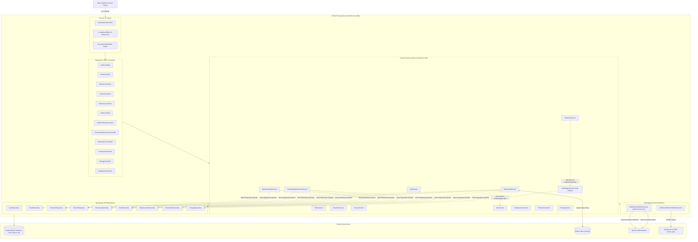
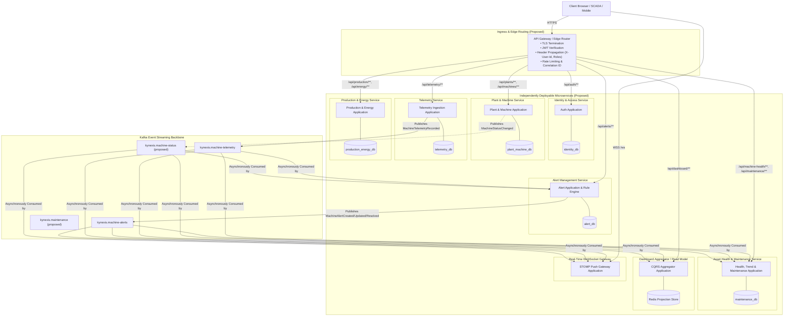
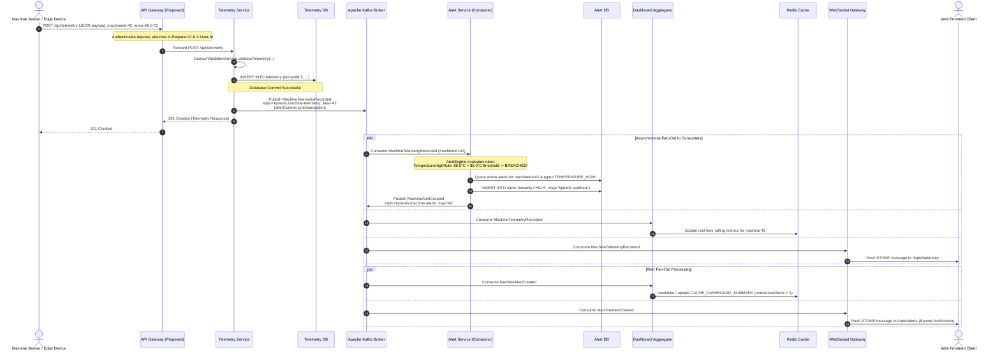

# KYNEXIS — Phase 21: Microservices Architecture Foundation

## Document Metadata
- **Project**: KYNEXIS — Connected Industrial Intelligence
- **Repository**: `https://github.com/RutujaKshetrapale/Kynexis`
- **Phase**: Phase 21 — Microservices Architecture Foundation
- **Date**: October 2026
- **Status**: Implemented & Documented (Architectural Baseline)
- **Target Backend**: `Backend/SpringBoot-Factory-Application`

---

## 1. Executive Summary & Phase Objectives

### 1.1 Context & Purpose
KYNEXIS has reached a high degree of maturity as a modular Spring Boot monolith. Over Phases 1 through 20.1, the application established:
- Comprehensive domain coverage (Plants, Machines, Sensors, Telemetry, Alerts, Maintenance, Production, Energy, Users);
- Stateless JWT authentication and role-based security;
- Industrial alert threshold evaluation;
- Heuristic predictive maintenance and health scoring;
- Redis caching for dashboard read paths;
- Apache Kafka event streaming with per-machine partition ordering and transaction-synchronized publication hardening (Phase 20 / 20.1).

The objective of **Phase 21: Microservices Architecture Foundation** is to define a production-grade target microservices architecture and an incremental, zero-downtime evolutionary migration strategy. Rather than performing a high-risk, all-at-once decomposition, Phase 21 establishes:
1. **Bounded-Context Boundaries**: Grounded directly in the current implementation;
2. **Service Responsibility Matrix**: Clear ownership of entities, APIs, and Kafka events;
3. **Communication Contracts**: Synchronous REST vs. asynchronous domain events;
4. **Database Ownership Strategy**: Preserving `smart_factory_db` while mapping a staged path toward database-per-service;
5. **Security & Identity Propagation Model**: Preserving role-based access control and correlation tracing;
6. **Delivery Guarantees & Observability**: Disclosing existing delivery limitations and defining future transactional outbox requirements;
7. **Staged Migration Roadmap**: Multi-phase evolution from monolith to distributed microservices.

### 1.2 Non-Goals for Phase 21
- **No Physical Service Extraction**: The monolith remains intact as a single deployable artifact in this phase.
- **No Database Separation**: The database `smart_factory_db` remains completely intact without schema or table modifications.
- **No New Runtime Infrastructure**: No premature addition of Spring Cloud Gateway, Netflix Eureka, Consul, Spring Cloud Config Server, or Resilience4j until physically justified in extraction phases.

---

## 2. Bounded Context Definition & Domain Modeling

Evaluation of the existing repository identifies seven distinct Bounded Contexts. Every domain is analyzed against current controllers, services, repositories, and database tables.

```text
┌─────────────────────────────────────────────────────────────────────────────┐
│                             KYNEXIS PLATFORM                                │
├───────────────────────────────┬─────────────────────────────────────────────┤
│ Core Operational Contexts     │ Supporting & Read-Model Contexts            │
├───────────────────────────────┼─────────────────────────────────────────────┤
│ 1. Identity & Access          │ 5. Health & Predictive Maintenance          │
│ 2. Plant & Machine Management │ 6. Production & Energy Tracking             │
│ 3. Telemetry Ingestion        │ 7. Dashboard Aggregation (Read Model)       │
│ 4. Alert Management           │                                             │
└───────────────────────────────┴─────────────────────────────────────────────┘
```

### 2.1 Identity & Access
- **Responsibilities**: User registration, credential verification, bcrypt password hashing, JWT generation and validation, role assignments (`ADMIN`, `OPERATOR`, `ENGINEER`, `MANAGER`), and public/secured route protection.
- **Current Source**:
  - Entity: `com.example.demo.entity.User`, `Role`
  - Repository: `com.example.demo.repository.UserRepository`
  - Service: `com.example.demo.service.AuthService`
  - Controller: `com.example.demo.controller.AuthController`
  - Security: `com.example.demo.security.JwtService`, `JwtAuthenticationFilter`, `RestAuthenticationEntryPoint`, `RestAccessDeniedHandler`
  - DTOs: `LoginRequest`, `LoginResponse`, `RegisterRequest`, `UserResponse`
  - Tables: `users`
- **Target Role**: Becomes `kynexis-identity-service`, responsible for authenticating users and minting cryptographically signed JWT tokens containing user identity and authority claims.

### 2.2 Plant & Machine Management
- **Responsibilities**: Plant records and locations, machine asset inventory, machine types, machine operational status (`ACTIVE`, `IDLE`, `OFFLINE`, `STOPPED`, `MAINTENANCE`), machine metadata updates, sensor registry, and physical sensor associations.
- **Current Source**:
  - Entities: `com.example.demo.entity.Plant`, `Machine`, `Sensor`
  - Repositories: `com.example.demo.repository.PlantRepository`, `MachineRepository`, `SensorRepository`
  - Services: `com.example.demo.service.PlantService`, `MachineService`, `SensorService`, `DomainValidationService`
  - Controllers: `com.example.demo.controller.PlantController`, `MachineController`, `SensorController`
  - DTOs: `PlantRequest`, `MachineRequest`, `SensorRequest`
  - WebSocket: Dispatches machine status changes to `/topic/machine-status`
  - Tables: `plants`, `machines`, `sensors`
- **Target Role**: Becomes `kynexis-plant-machine-service`, the authoritative source of truth for plant topology, machine equipment, and sensor configurations.

### 2.3 Telemetry
- **Responsibilities**: Ingesting high-frequency time-series sensor telemetry (temperature, vibration, pressure, rotational speed RPM), validating sensor values against domain physical constraints, persisting telemetry records, querying historical telemetry by machine and time range, and publishing domain events to Kafka.
- **Current Source**:
  - Entity: `com.example.demo.entity.Telemetry`
  - Repository: `com.example.demo.repository.TelemetryRepository`
  - Service: `com.example.demo.service.TelemetryService`, `DomainValidationService`
  - Controller: `com.example.demo.controller.TelemetryController`
  - DTO: `TelemetryRequest`
  - WebSocket: Dispatches readings to `/topic/telemetry`
  - Kafka: Publishes `MachineTelemetryRecorded` to `kynexis.machine-telemetry`
  - Tables: `telemetry`
- **Target Role**: Becomes `kynexis-telemetry-service`, optimized for high-throughput write ingestion, append-only time-series persistence, and decoupled streaming to Kafka.

### 2.4 Alert Management
- **Responsibilities**: Automated industrial alert rule evaluation, alert lifecycle management (triggering, updating severity, auto-resolving, manual resolving), querying active/resolved alerts, and streaming alert domain events.
- **Current Source**:
  - Entity: `com.example.demo.entity.Alert`
  - Repository: `com.example.demo.repository.AlertRepository`
  - Services: `com.example.demo.service.AlertService`, `com.example.demo.service.alert.AlertEngineService`, `AlertRule`, `TemperatureHighRule`, `MachineStatusRule`, etc.
  - Controller: `com.example.demo.controller.AlertController`
  - DTO: `AlertRequest`
  - WebSocket: Dispatches alert changes to `/topic/alerts`
  - Kafka: Publishes `MachineAlertCreated`, `MachineAlertUpdated`, `MachineAlertResolved` to `kynexis.machine-alerts`
  - Tables: `alerts`
- **Target Role**: Becomes `kynexis-alert-service`. In the target microservices architecture, it consumes `MachineTelemetryRecorded` asynchronously from Kafka, eliminating the synchronous in-process coupling between Telemetry ingestion and Alert evaluation.

### 2.5 Health and Predictive Maintenance
- **Responsibilities**: Calculating real-time composite machine health scores (`NORMAL`, `DEGRADED`, `CRITICAL`), assessing telemetry freshness and staleness (24h window), evaluating multi-day telemetry trends (temperature rise, vibration rise, pressure drift, RPM drift), evaluating maintenance history, categorizing failure risk (`LOW`, `MEDIUM`, `HIGH`, `CRITICAL`), emitting actionable maintenance recommendations, and managing maintenance work orders.
- **Current Source**:
  - Entity: `com.example.demo.entity.Maintenance`
  - Repository: `com.example.demo.repository.MaintenanceRepository`
  - Services: `com.example.demo.service.MachineHealthService`, `PredictiveMaintenanceService`, `MaintenanceService`
  - Controllers: `com.example.demo.controller.MachineHealthController`, `PredictiveMaintenanceController`, `MaintenanceController`
  - DTOs: `MachineHealthResponse`, `PredictiveMaintenanceResponse`, `MaintenanceRequest`
  - Models: `HealthState`, `DataSufficiency`, `MaintenanceRiskCategory`
  - WebSocket: Dispatches maintenance updates to `/topic/maintenance`
  - Tables: `maintenance`
- **Architecture Decision (Unified Service Rationale)**:
  - *Decision*: Machine Health, Heuristic Predictive Maintenance, and Maintenance Operations initially form a single unified bounded context: **Asset Health & Maintenance Service** (`kynexis-health-maintenance-service`).
  - *Rationale*: Both `MachineHealthService` and `PredictiveMaintenanceService` consume identical cross-domain data: latest telemetry readings, active unresolved alerts, and machine operational state. Splitting them into separate microservices prematurely would introduce redundant Kafka consumers, duplicate caching pipelines, and high inter-service chatter without any deployment benefit.
  - *Honest Heuristic Disclosure*: The predictive maintenance engine in KYNEXIS is a **deterministic rule-based heuristic trend analyzer** (configured via `PredictiveMaintenanceProperties` with threshold limits for temperature rise, vibration rise, and drift), combined with active system alerts. It is **not** a machine-learning model or neural network. When advanced AI/ML models are introduced in Phase 26, the ML inference engine can be separated into an independent asynchronous worker service.

### 2.6 Production, Energy, and Dashboard Read Models
- **Responsibilities**:
  - *Production*: Tracking manufacturing production runs, product names, quantities produced, quantities rejected, start/end timestamps, and run status (`COMPLETED`, `IN_PROGRESS`, `PLANNED`).
  - *Energy*: Tracking electrical power consumption (kWh) per machine and time period.
  - *Dashboard*: Aggregating high-level executive metrics (total plants, total machines, active machines, total sensors, unresolved alerts, total production, rejected units, total energy consumption) and caching summaries in Redis.
- **Current Source**:
  - Entities: `com.example.demo.entity.Production`, `Energy`
  - Repositories: `com.example.demo.repository.ProductionRepository`, `EnergyRepository`
  - Services: `com.example.demo.service.ProductionService`, `EnergyService`, `DashboardService`
  - Controllers: `com.example.demo.controller.ProductionController`, `EnergyController`, `DashboardController`
  - DTOs: `ProductionRequest`, `EnergyRequest`, `DashboardSummaryResponse`, `DashboardMachineStatusResponse`
  - Cache: Redis caches `CACHE_DASHBOARD_SUMMARY` and `CACHE_DASHBOARD_MACHINE_STATUS` (15s TTL, evicted on entity writes)
  - Tables: `production`, `energy`
- **Architecture Decision (Production/Energy vs. Dashboard Aggregation)**:
  - *Decision*: Production and Energy belong together as transactional shop-floor tracking services (**Production & Energy Tracking Service**).
  - *Decision*: Dashboard is **NOT** a standalone transactional microservice. It is a **read-oriented aggregation layer / CQRS read projection**.
  - *Rationale*: In the monolith, `DashboardService` directly queries six different domain repositories (`PlantRepository`, `MachineRepository`, `SensorRepository`, `AlertRepository`, `ProductionRepository`, `EnergyRepository`). In a microservices architecture, having a separate service write to or directly query all other databases would violate database encapsulation. Instead, dashboard read views should be served either by an API Gateway aggregator or a CQRS projection worker that updates a Redis read model asynchronously from Kafka domain events.

---

## 3. Current-State Architecture (Section 4.1)

### 3.1 Monolithic Architecture Inventory

| Architectural Layer | Implementation Technology | Key Classes & Configuration |
|---|---|---|
| **Runtime & Framework** | Java 21, Spring Boot 4.0.7 | Maven build, `pom.xml`, `SpringBootFactoryApplication.java` |
| **Persistence & ORM** | MySQL 8.2, Spring Data JPA, Hibernate (validate mode) | HikariCP pool (10 max, 2 min idle), `smart_factory_db`, 9 relational tables |
| **Database Migrations** | Flyway 10.x (`flyway-mysql`) | `V1__initial_schema.sql`, `V2__seed_initial_data.sql` |
| **In-Memory Cache** | Redis 7.x, Lettuce client, Spring Cache | `CacheConfig.java`, `KynexisCacheErrorHandler.java` (fallback on error), 15s TTL |
| **Event Streaming** | Apache Kafka 3.x, Spring Kafka Producer | `KafkaProducerConfig.java`, `KafkaEventPublisherService.java`, topics: `kynexis.machine-telemetry`, `kynexis.machine-alerts` |
| **Real-Time Push** | WebSocket / STOMP (`/ws`) | `WebSocketConfig.java`, `WebSocketEventPublisherService.java`, broker topics: `/topic/*` |
| **Security & Auth** | Spring Security 6.x, JJWT 0.13.0 | `SecurityConfig.java`, `JwtAuthenticationFilter.java`, stateless JWT tokens, BCrypt |
| **API Documentation** | SpringDoc OpenAPI 3.1 (`springdoc-openapi-starter-webmvc-ui:3.1.1`) | `OpenAPIConfig.java`, `/swagger-ui.html`, `/v3/api-docs` |
| **Observability** | Spring Boot Actuator, Logback, SLF4J MDC | `/actuator/health`, `/actuator/info`, `/actuator/metrics`, `CorrelationIdFilter.java` (`X-Request-ID`) |
| **Testing** | JUnit 5, Mockito, MockMvc, H2 in-memory DB | 89 test classes, 628 automated tests, isolated H2 testing without live Kafka/Redis requirement |

### 3.2 Monolith Package Structure
```text
Backend/SpringBoot-Factory-Application/src/main/java/com/example/demo/
├── SpringBootFactoryApplication.java
├── architecture/                     # Phase 21: BoundedContext, DomainBoundary, Contracts
│   ├── BoundedContext.java
│   ├── DomainBoundary.java
│   └── contract/
│       ├── MachineQueryContract.java
│       └── dto/MachineSummaryDTO.java
├── config/                           # Application configuration beans
│   ├── ActuatorInfoConfig.java
│   ├── AlertEngineProperties.java
│   ├── CacheConfig.java
│   ├── KafkaProducerConfig.java
│   ├── KynexisCacheErrorHandler.java
│   ├── KynexisCacheProperties.java
│   ├── KynexisKafkaProperties.java
│   ├── MachineHealthProperties.java
│   ├── OpenAPIConfig.java
│   ├── PasswordConfig.java
│   ├── PredictiveMaintenanceProperties.java
│   ├── SecurityConfig.java
│   └── WebSocketConfig.java
├── controller/                       # REST endpoint controllers (11 controllers)
├── dto/                              # Request/Response data transfer objects
│   └── event/                        # Kafka event DTO contracts (KynexisEvent, etc.)
├── entity/                           # JPA database entities (9 entities)
├── exception/                        # Global exception handling & error responses
├── logging/                          # MDC correlation filter & logging constants
├── model/                            # Domain enums & domain models
├── repository/                       # Spring Data JPA repositories (9 repositories)
├── security/                         # JWT service, security filters, entry points
├── service/                          # Core business services (15 services)
│   └── alert/                        # Alert rule engine & rule strategies
└── util/                             # Pagination & query utilities
```

### 3.3 Implemented vs. Proposed Component Distinction

| Component | Status in Codebase | Verification & Evidence |
|---|---|---|
| Single Spring Boot Monolith | **Implemented** | Working application in `Backend/SpringBoot-Factory-Application` |
| MySQL Database (`smart_factory_db`) | **Implemented** | Flyway V1 schema & V2 seed data; validated in H2 test suite |
| Redis Dashboard Caching | **Implemented** | `@Cacheable` and `@CacheEvict` in `DashboardService`, `MachineService`, etc. |
| Kafka Event Producer | **Implemented** | `KafkaEventPublisherService` with `afterCommit` transaction synchronization |
| WebSocket STOMP Gateway | **Implemented** | `WebSocketConfig` mapping `/ws`, publishing to `/topic/*` |
| Stateless JWT Security | **Implemented** | `JwtAuthenticationFilter`, `SecurityConfig`, role-based route protection |
| Service Contract Interfaces | **Implemented (Phase 21)** | `MachineQueryContract`, `DomainBoundary` annotations, tested in test suite |
| Independent Microservice Artifacts | **Proposed** | Explicitly deferred to extraction phases (Phase 22+) |
| Dedicated Service Databases | **Proposed** | Database-per-service strategy documented for future extraction |
| API Gateway / Reverse Proxy | **Proposed** | Documented as target edge router; does not exist currently |
| Service Discovery (Eureka/Consul) | **Proposed** | Not implemented; evaluated as unnecessary if container DNS is used |
| Kafka Event Consumers | **Proposed** | Currently external downstream systems consume events; internal consumers deferred |
| Transactional Outbox Pattern | **Proposed** | Documented as future reliability enhancement |

---

## 4. Target-State Microservices Architecture (Section 4.2)

### 4.1 Target Microservice Topology

In the target architecture, KYNEXIS evolves from a single monolith into six business microservices and an Edge Gateway / Aggregator layer:

```text
                                 [ Web Clients / Mobile / SCADA HMI ]
                                                  │
                                                  │ HTTPS / WSS
                                                  ▼
                         ┌──────────────────────────────────────────────────┐
                         │           API Gateway / Edge Router              │
                         │   (TLS, Auth Validation, Rate Limiting, CORS)    │
                         └───────┬──────────────────────────────────┬───────┘
                                 │                                  │
                  Internal HTTP  │                                  │ Internal HTTP
                 (Authenticated) │                                  │ (Aggregated)
                                 ▼                                  ▼
      ┌────────────────────────────────────────────────┐  ┌─────────────────────────────────┐
      │          Core Business Services                │  │  Dashboard Read Model / BFF     │
      │  ┌──────────────────────────────────────────┐  │  │  (Redis CQRS Projection Store)  │
      │  │ 1. Identity & Access Service             │  │  └────────────────┬────────────────┘
      │  │    (Users, Auth, Roles, JWT)             │  │                   ▲
      │  ├──────────────────────────────────────────┤  │                   │
      │  │ 2. Plant & Machine Service               │  │                   │ Subscribes to
      │  │    (Plants, Machines, Sensors)           │  │                   │ events to build
      │  ├──────────────────────────────────────────┤  │                   │ read projections
      │  │ 3. Telemetry Ingestion Service           │──┼───────┐           │
      │  │    (High-throughput Sensor Readings)     │  │       │           │
      │  ├──────────────────────────────────────────┤  │       ▼           │
      │  │ 4. Alert Management Service              │◄─┼─ [ Apache Kafka ]─┤
      │  │    (Rules, Active Alerts, Life Cycle)    │  │   Event Backbone  │
      │  ├──────────────────────────────────────────┤  │       ▲     ▲     │
      │  │ 5. Asset Health & Maintenance Service    │◄─┼───────┘     │     │
      │  │    (Trend Analysis, Health Score, Tasks) │  │             │     │
      │  ├──────────────────────────────────────────┤  │             │     │
      │  │ 6. Production & Energy Service           │──┼─────────────┘     │
      │  │    (Output, Rejects, Energy Readings)    │  │                   │
      │  └──────────────────────────────────────────┘  │                   │
      └────────────────────────────────────────────────┘                   │
                                                                           │
                         ┌─────────────────────────────────────────────────┴┐
                         │           WebSocket Real-Time Gateway            │
                         │  (Relays Kafka events to STOMP /topic/* clients) │
                         └──────────────────────────────────────────────────┘
```

### 4.2 Architectural Pillars

#### 1. API Gateway / Edge Routing
- **Ingress Point**: Centralized entry point (`/api/**`) terminating external client TLS.
- **Edge Security**: Validates incoming JWT signatures using the public key / shared secret of the Identity Service.
- **Identity Propagation**: Injects authenticated identity headers into downstream requests:
  - `X-User-Id`: Subject identifier (username or user ID);
  - `X-User-Roles`: Comma-separated list of granted authorities (`ROLE_ADMIN`, `ROLE_OPERATOR`, etc.);
  - `X-User-Email`: User email address;
  - `X-Request-ID`: Distributed correlation ID (propagated via MDC).
- **Internal Protection**: Downstream services are placed in a private network subnet. They reject external requests that bypass the Gateway and lack valid internal identity headers.

#### 2. Synchronous REST vs. Asynchronous Kafka Streaming
- **Synchronous HTTP/REST (OpenAPI 3.1)**: Reserved strictly for immediate request-response interactions:
  - User login & token retrieval;
  - Real-time queries for machine status by ID;
  - Form submission commands (scheduling maintenance, updating plant configuration);
  - Paginated administrative audit queries.
- **Asynchronous Domain Events (Apache Kafka)**: Used for all decoupled, time-sensitive, and multi-consumer flows:
  - Ingested telemetry broadcast (`kynexis.machine-telemetry`);
  - Alert state transitions (`kynexis.machine-alerts`);
  - Machine operational status changes;
  - Real-time dashboard view updates.

#### 3. Database-per-Service Pattern
- Each extracted microservice owns its private database schema.
- **Zero Cross-Service Queries**: Direct SQL queries or foreign keys between different service databases are strictly prohibited.
- **Foreign Key Replacement**: Relational `FOREIGN KEY ... ON DELETE RESTRICT` constraints across bounded contexts are replaced with **logical identifiers** (`machine_id BIGINT`).
- **Data Integrity**: Enforced through domain events, validation contracts, and compensating sagas.

#### 4. Real-Time Push Gateway
- In the monolith, `WebSocketEventPublisherService` pushes messages directly from within service methods.
- In the target architecture, a dedicated **WebSocket Push Service** subscribes to Kafka topics (`kynexis.machine-telemetry`, `kynexis.machine-alerts`, `kynexis.machine-status`, etc.) and broadcasts STOMP frames over `/topic/*` to connected frontend browsers.

#### 5. Centralized Observability & Health Monitoring
- **Health Probes**: Every service exposes standardized Actuator endpoints (`/actuator/health/liveness` and `/actuator/health/readiness`).
- **Distributed Tracing**: Implementation of W3C TraceContext standards (`traceparent` header), linking HTTP REST requests, Kafka record headers, and internal database queries.
- **Log Aggregation**: Structured JSON logs enriched with `requestId`, `machineId`, and `serviceName`.

---

## 5. Service Responsibility Matrix (Section 4.3)

| Service Name | Business Responsibility | Owned Entities & Tables | Exposed API Contracts | Published Kafka Events | Consumed Kafka Events | External Dependencies | Auth Requirements | Migration Priority |
|---|---|---|---|---|---|---|---|---|
| **Identity & Access Service** (`kynexis-identity-service`) | Authentication, password management, role-based authorization, JWT token generation & verification | `User`, `Role`<br>`users` | `POST /api/auth/login`<br>`POST /api/auth/register`<br>`GET /api/auth/me`<br>`GET /api/users` | None | None | MySQL (`identity_db`) | Public login/register; Admin for user management | **Stage 3 (High - Low Coupling)** |
| **Plant & Machine Service** (`kynexis-plant-machine-service`) | Plant locations, machine asset registry, machine status management, sensor hardware catalogue | `Plant`, `Machine`, `Sensor`<br>`plants`, `machines`, `sensors` | `CRUD /api/plants/**`<br>`CRUD /api/machines/**`<br>`CRUD /api/sensors/**`<br>`GET /api/machines/status/{status}` | `MachineStatusChanged` (target) | None | MySQL (`plant_machine_db`) | Authenticated; Admin/Manager for mutations | **Stage 5 (Foundational Core)** |
| **Telemetry Ingestion Service** (`kynexis-telemetry-service`) | High-frequency sensor ingestion, domain range validation, time-series storage, historical range queries | `Telemetry`<br>`telemetry` | `POST /api/telemetry`<br>`GET /api/telemetry/**`<br>`GET /api/telemetry/machine/{id}` | `MachineTelemetryRecorded` | None | MySQL/TimescaleDB (`telemetry_db`), Kafka broker | Authenticated; Operator/Engineer ingestion | **Stage 5 (High Throughput)** |
| **Alert Management Service** (`kynexis-alert-service`) | Automated alert rule evaluation (temperature, vibration, pressure, rpm, status), alert state lifecycle, resolution tracking | `Alert`<br>`alerts` | `CRUD /api/alerts/**`<br>`GET /api/alerts/unresolved`<br>`GET /api/alerts/machine/{id}`<br>`PUT /api/alerts/{id}/resolve` | `MachineAlertCreated`<br>`MachineAlertUpdated`<br>`MachineAlertResolved` | `MachineTelemetryRecorded`<br>`MachineStatusChanged` | MySQL (`alert_db`), Kafka broker | Authenticated; Operator/Engineer resolution | **Stage 4 (Medium Coupling)** |
| **Asset Health & Maintenance Service** (`kynexis-health-maintenance-service`) | Composite health scoring, heuristic multi-day trend analysis, anomaly risk assessment, maintenance work order lifecycle | `Maintenance`<br>`maintenance`<br>(read cache of health/predictions) | `GET /api/machine-health/**`<br>`GET /api/predictive-maintenance/**`<br>`CRUD /api/maintenance/**` | `MaintenanceScheduled`<br>`MaintenanceCompleted` (target) | `MachineTelemetryRecorded`<br>`MachineAlertCreated`<br>`MachineAlertResolved` | MySQL (`maintenance_db`), Redis cache, Kafka broker | Authenticated; Engineer/Manager | **Stage 4 (Medium Coupling)** |
| **Production & Energy Service** (`kynexis-production-energy-service`) | Shop-floor production tracking, batch defect rates, manufacturing status, electrical power consumption metrics | `Production`, `Energy`<br>`production`, `energy` | `CRUD /api/production/**`<br>`CRUD /api/energy/**`<br>`GET /api/energy/machine/{id}` | `ProductionRunCompleted`<br>`EnergyThresholdExceeded` (target) | None | MySQL (`production_energy_db`) | Authenticated; Operator/Manager | **Stage 3 (High - Low Coupling)** |
| **Dashboard Aggregator / Read Model** (`kynexis-gateway-aggregator`) | Cross-domain metric aggregation, CQRS read projection maintenance, low-latency executive dashboard views | None (In-memory / Redis projections) | `GET /api/dashboard/summary`<br>`GET /api/dashboard/machine-status` | None | Subscribes to all domain events to update Redis | Redis cluster | Authenticated; All roles | **Stage 2 / Continuous** |

---

## 6. Architecture Diagrams (Section 4.4)

### 6.1 Current-State Monolith Architecture



---

### 6.2 Proposed Target-State Microservices Architecture



---

### 6.3 Telemetry-to-Alert-to-Dashboard Event Flow



---

### 6.4 Staged Migration Sequence

```mermaid
graph TD
    Phase21["Phase 21 (Current Phase)<br/>• Architectural baseline & Bounded Contexts<br/>• Service Contract Interfaces (MachineQueryContract)<br/>• DomainBoundary annotations<br/>• Monolith preserved 100%"]
    
    Phase22["Phase 22 (Containerization Foundation)<br/>• Multi-stage Docker build for backend<br/>• Docker Compose orchestration (App, MySQL, Redis, Kafka)<br/>• Environment variable configuration parity"]

    Phase23["Phase 23 (Contract Decoupling & Outbox)<br/>• Replace direct cross-domain service calls with internal contracts<br/>• Introduce Transactional Outbox pattern in MySQL<br/>• Guarantee at-least-once Kafka publication"]

    Phase24["Phase 24 (Low-Coupling Extraction)<br/>• Extract kynexis-identity-service<br/>• Extract kynexis-production-energy-service<br/>• Introduce API Gateway for edge routing<br/>• Monolith delegates Auth to Identity Service"]

    Phase25["Phase 25 (Alert & Health Extraction)<br/>• Extract kynexis-alert-service<br/>• Alert service consumes Kafka MachineTelemetryRecorded<br/>• Remove in-process evaluateTelemetry call from TelemetryService<br/>• Extract kynexis-health-maintenance-service"]

    Phase26["Phase 26 (Core Telemetry & Complete Decomposition)<br/>• Extract kynexis-telemetry-service & kynexis-plant-machine-service<br/>• Separate smart_factory_db into isolated service databases<br/>• Extract dedicated WebSocket push gateway<br/>• Fully distributed microservices architecture achieved"]

    Phase21 --> Phase22
    Phase22 --> Phase23
    Phase23 --> Phase24
    Phase24 --> Phase25
    Phase25 --> Phase26
```



---

## 7. Database Ownership and Migration (Section 4.5)

### 7.1 Existing Database Preservation: `smart_factory_db`
The current database is `smart_factory_db`, structured under Flyway migrations `V1__initial_schema.sql` and `V2__seed_initial_data.sql`. It contains nine relational tables:
1. `users`: Credentials, username, email, role, active flag.
2. `plants`: Manufacturing plant name, location, active status.
3. `machines`: Machine name, type, operational status, plant foreign key.
4. `sensors`: Sensor name, type, measurement unit, active flag, machine foreign key.
5. `telemetry`: High-frequency sensor readings (temperature, vibration, pressure, rpm, timestamp, machine foreign key).
6. `alerts`: Alert type, severity, message, resolution status, creation timestamp, machine foreign key, nullable telemetry foreign key.
7. `maintenance`: Maintenance type, description, scheduled date, completed date, status, technician, machine foreign key.
8. `production`: Product name, quantity produced, quantity rejected, start/end timestamps, status, machine foreign key.
9. `energy`: Energy consumption reading, recorded timestamp, machine foreign key.

**Mandatory Constraint**: In Phase 21, `smart_factory_db` is **100% preserved**. No tables are split, renamed, truncated, or dropped.

### 7.2 Logical Table Ownership Mapping

```text
┌──────────────────────────────────────┬────────────────────────────────────┐
│ Bounded Context / Candidate Service  │ Logically Owned Tables             │
├──────────────────────────────────────┼────────────────────────────────────┤
│ Identity & Access Service            │ users                              │
│ Plant & Machine Management Service   │ plants, machines, sensors          │
│ Telemetry Service                    │ telemetry                          │
│ Alert Management Service             │ alerts                             │
│ Asset Health & Maintenance Service   │ maintenance                        │
│ Production & Energy Service          │ production, energy                 │
│ Dashboard Aggregator (Read Model)    │ None (Owns Redis cache keys)       │
└──────────────────────────────────────┴────────────────────────────────────┘
```

### 7.3 Foreign-Key Decoupling Strategy
In `V1__initial_schema.sql`, eight foreign keys enforce referential integrity across bounded contexts with `ON DELETE RESTRICT`:
- `fk_machine_plant`: `machines.plant_id -> plants.id` (intra-domain: Plant & Machine service)
- `fk_sensor_machine`: `sensors.machine_id -> machines.id` (intra-domain: Plant & Machine service)
- `fk_telemetry_machine`: `telemetry.machine_id -> machines.id` (cross-domain: Telemetry -> Machine)
- `fk_alert_machine`: `alerts.machine_id -> machines.id` (cross-domain: Alert -> Machine)
- `fk_alert_telemetry`: `alerts.telemetry_id -> telemetry.id` (cross-domain: Alert -> Telemetry)
- `fk_maintenance_machine`: `maintenance.machine_id -> machines.id` (cross-domain: Maintenance -> Machine)
- `fk_production_machine`: `production.machine_id -> machines.id` (cross-domain: Production -> Machine)
- `fk_energy_machine`: `energy.machine_id -> machines.id` (cross-domain: Energy -> Machine)

#### Migration Evolution for Foreign Keys:
1. **Stage A (Current Monolith)**: Retain physical foreign key constraints in `smart_factory_db`.
2. **Stage B (Logical Schema Isolation)**: Group tables into logical schemas (`kynexis_identity`, `kynexis_plant_machine`, `kynexis_telemetry`, `kynexis_alert`, `kynexis_maintenance`, `kynexis_production_energy`) within the same MySQL database instance.
3. **Stage C (Soft Key Migration)**: Drop cross-schema foreign key constraints (`fk_telemetry_machine`, `fk_alert_machine`, etc.) while retaining indexed columns (`machine_id BIGINT NOT NULL`). Replace physical joins with:
   - Synchronous validation via `MachineQueryContract` / REST API;
   - Asynchronous cache replication (e.g. Telemetry service caches a local bitmap/hash of valid `machineId`s);
   - Nullable telemetry references in alerts (`telemetry_id BIGINT NULL` stored as an informational reference without database-level constraint).
4. **Stage D (Physical Database Separation)**: Move each schema to its own independent MySQL / time-series database cluster with dedicated connection pools and isolated Flyway migration paths.

### 7.4 Zero-Downtime Data Migration & Backfill Procedure
When a service is extracted to a dedicated database:
1. **Schema Provisioning**: Target database initialized via service-specific Flyway migration `V1_0__init_service_schema.sql`.
2. **Initial Snapshot Replication**: Historical records extracted from `smart_factory_db` using a consistent read lock (`mysqldump --single-transaction`) or Change Data Capture (CDC via Debezium) and loaded into the target database.
3. **Dual-Write / CDC Catch-Up**: Monolith writes to both the old table and the new service, or Debezium replicates changes until lag reaches zero.
4. **Verification & Cutover**: Read verification script asserts 100% row match. API traffic switched to the new microservice.
5. **Deprecation**: Monolith table marked read-only, then dropped in a subsequent cleanup migration.

---

## 8. Kafka Event Contracts & Streaming Reliability (Section 4.6)

### 8.1 Active Event Contracts Inventory

All active event contracts implement `com.example.demo.dto.event.KynexisEvent` and are serialized with Jackson using ISO-8601 formatting:

| Event Name | Topic Name | Partition Key | Schema Version | Description |
|---|---|---|---|---|
| `MachineTelemetryRecorded` | `kynexis.machine-telemetry` | `String.valueOf(machineId)` | `"1.0"` | Published when new sensor telemetry (temp, vib, press, rpm) is persisted. |
| `MachineAlertCreated` | `kynexis.machine-alerts` | `String.valueOf(machineId)` | `"1.0"` | Published when a rule condition is breached and a new alert is generated. |
| `MachineAlertUpdated` | `kynexis.machine-alerts` | `String.valueOf(machineId)` | `"1.0"` | Published when an open alert undergoes a meaningful severity or message update. |
| `MachineAlertResolved` | `kynexis.machine-alerts` | `String.valueOf(machineId)` | `"1.0"` | Published when an open alert is marked as resolved (auto or manual). |

### 8.2 Partitioning & Ordering Guarantees
- **Partition Key**: `String.valueOf(machineId)`.
- **Ordering Semantics**: Under Kafka's default Murmur2 partitioner, all events for a specific machine asset are guaranteed to map to the exact same partition. Kafka enforces **strict FIFO chronological order within a partition**.
- **Global Ordering Notice**: Ordering across different machines (different partitions) is neither guaranteed nor required. Consumers process per-machine event streams sequentially.

### 8.3 Timestamp & Time Semantics
- Event timestamp fields (`timestamp`, `telemetryTimestamp`, `alertCreatedAt`) use `java.time.LocalDateTime` formatted as ISO-8601 strings (`yyyy-MM-dd'T'HH:mm:ss`) via `@JsonFormat`.
- They reflect **plant local time** synchronized with the underlying database columns (`telemetry.timestamp DATETIME`, `alerts.created_at DATETIME`).
- In the future microservices target state, timestamps will transition to UTC `Instant` formatted as ISO-8601 UTC strings (`yyyy-MM-dd'T'HH:mm:ss.SSS'Z'`) with dual-format backward-compatible JSON deserializers.

### 8.4 Transactional Publication & Known Delivery Limitations
- **Current Monolith Semantics (Phases 20 & 20.1)**:
  - Events are published using Spring `TransactionSynchronizationManager.registerSynchronization` with an `afterCommit` hook.
  - If a transaction rolls back, `afterCompletion` cancels publication and exceptionally completes the returned `CompletableFuture`, preventing ghost notifications.
- **Honest Architectural Disclosure**:
  - The after-commit publishing mechanism **does not utilize a Transactional Outbox pattern**.
  - If the application JVM crashes **after** the MySQL transaction commits but **before** the asynchronous Kafka send completes, the event will not be delivered to Kafka.
  - Therefore, the current delivery guarantee across server crashes is **at-most-once**.
- **Future Transactional Outbox Recommendation (Phase 23)**:
  - For true **at-least-once** end-to-end delivery, Phase 23 should introduce an `outbox_events` table in each service database.
  - Domain changes and outbox records are committed in the same ACID transaction. An asynchronous relay (Debezium CDC or polling worker) reads the outbox table and dispatches records to Kafka with retries.

### 8.5 Idempotent Consumer Design Requirements
Because network retries and rebalances can cause duplicate event delivery, all future microservice consumers must be idempotent:
1. **Deduplication Key**: Every event contains a globally unique UUID `eventId`.
2. **Deduplication Store**: Consumers must store processed `eventId`s in a local database table (`processed_events(event_id VARCHAR(36) PRIMARY KEY, processed_at DATETIME)`) or Redis set with TTL.
3. **Check-and-Process**: Consumers check if `eventId` exists before processing business logic. If present, the message is acknowledged and skipped.
4. **Dead-Letter Topics (`.DLT`)**: Messages that repeatedly fail processing after configured retries (e.g. 3 attempts with exponential backoff) must be routed to `kynexis.machine-telemetry.DLT` or `kynexis.machine-alerts.DLT` for administrative inspection without stalling the partition.

---

## 9. Security Model & Identity Propagation (Section 4.7)

### 9.1 Authentication & Token Lifecycle
1. **Authentication Ingress**: Clients authenticate via `POST /api/auth/login` with username and password.
2. **JWT Issuance**: `AuthService` validates credentials and generates a signed JWT token containing:
   - `sub`: Username;
   - `role`: User role (`ROLE_ADMIN`, `ROLE_OPERATOR`, `ROLE_ENGINEER`, `ROLE_MANAGER`);
   - `exp`: Expiration timestamp (default: 1 hour / 3600000 ms);
   - `iat`: Issued-at timestamp.
3. **Stateless Verification**: Downstream requests present `Authorization: Bearer <token>`. The Gateway or service validates signature and expiration without querying the database on every request.

### 9.2 Identity Propagation Across Service Boundaries
In a distributed topology, downstream microservices should not each re-parse and re-validate raw JWT tokens from scratch. Instead:
- **Gateway Edge Validation**: The API Gateway validates the client JWT once at the edge.
- **Trusted Identity Headers**: The Gateway strips client-supplied `X-User-*` headers and injects validated headers:
  ```http
  X-User-Id: operator_john
  X-User-Roles: ROLE_OPERATOR
  X-User-Email: john@factory.kynexis.com
  X-Request-ID: c4b8923a-6941-45d2-b062-8e100f543187
  ```
- **Internal Security Context**: A lightweight `PreAuthenticatedAuthenticationProvider` or servlet filter in downstream services converts these headers into a Spring `SecurityContext`.

### 9.3 Service-to-Service (S2S) Authentication
Direct communication between internal services (e.g., when the Alert service queries the Plant & Machine service) requires mutual trust:
- **mTLS (Mutual TLS)**: In production Kubernetes or Docker Swarm environments, mTLS via Istio / Linkerd or internal certificates ensures network-layer encryption and mutual service identity.
- **Internal Service JWTs**: Services mint short-lived S2S JWTs signed with dedicated private keys, identifying the calling service (`iss: kynexis-alert-service`, `aud: kynexis-plant-machine-service`).

### 9.4 Secrets & Configuration Management
- Secrets (`JWT_SECRET`, `DB_PASSWORD`, `REDIS_PASSWORD`) are loaded strictly via environment variables.
- Default development fallback credentials (e.g. in `application.properties`) must be overridden in container environments using Docker secrets, Kubernetes secrets, or cloud key vaults (AWS Secrets Manager / HashiCorp Vault).

### 9.5 Network Isolation & Endpoint Protection
- Internal service ports (e.g., direct service HTTP endpoints, database ports 3306, Redis port 6379, Kafka port 9092) are bound to private container networks (`kynexis-internal-net`).
- Only the API Gateway (`8080`/`443`) and WebSocket port are exposed to the external network.

---

## 10. Phased Migration Roadmap (Section 4.8)

The migration from monolith to microservices follows the **Strangler Fig Application** pattern, extracting low-risk, loosely coupled domains first while keeping the system functional and tested at every step.

```text
┌─────────────────────────────────────────────────────────────────────────────┐
│                          MIGRATION ROADMAP PHASES                           │
├─────────┬─────────────────────────────────────────────────┬─────────────────┤
│ Stage   │ Description                                     │ Target Horizon  │
├─────────┼─────────────────────────────────────────────────┼─────────────────┤
│ Stage 1 │ Architectural Boundaries & Service Contracts    │ Phase 21 (Done) │
│ Stage 2 │ Containerization & Orchestration Parity         │ Phase 22        │
│ Stage 3 │ Contract Decoupling & Outbox Implementation     │ Phase 23        │
│ Stage 4 │ Extraction: Identity & Production/Energy        │ Phase 24        │
│ Stage 5 │ Extraction: Alert & Health/Maintenance Services │ Phase 25        │
│ Stage 6 │ Core Telemetry & Plant/Machine Extraction       │ Phase 26+       │
└─────────┴─────────────────────────────────────────────────┴─────────────────┘
```

### Stage 1: Architectural Boundaries & Service Contracts (Phase 21 — Current Phase)
- **Entry Criteria**: Monolith fully functional; Phase 20.1 Kafka transaction hardening complete; all 619 tests passing.
- **Deliverables**:
  - `BoundedContext` catalog and `DomainBoundary` annotations established;
  - `MachineQueryContract` interface and `MachineSummaryDTO` implemented in `MachineService`;
  - Complete architecture documentation (`microservices-architecture.md`);
  - Architectural verification test suite (`BoundedContextDefinitionTest`, `MachineQueryContractTest`, `DomainBoundaryMappingTest`).
- **Dependencies**: None. Monolith runtime and database untouched.
- **Rollback Consideration**: Purely additive code changes; zero risk to runtime behavior.

### Stage 2: Containerization & Orchestration Foundation (Phase 22)
- **Entry Criteria**: Phase 21 architectural baseline established.
- **Deliverables**:
  - Multi-stage Dockerfile for `SpringBoot-Factory-Application` (optimized layer caching, non-root user);
  - `docker-compose.yml` orchestrating Application, MySQL 8.2, Redis 7, Apache Kafka (KRaft mode), and Zookeeper/Kafka tools;
  - Health checks, network isolation, and environment variable configuration parity.
- **Dependencies**: Docker, Docker Compose.
- **Rollback Consideration**: Application continues to run natively via `mvn spring-boot:run`.

### Stage 3: Contract Decoupling & Transactional Outbox (Phase 23)
- **Entry Criteria**: Containerized monolith operational.
- **Deliverables**:
  - Replace direct repository calls between domains with service contracts (`MachineQueryContract`);
  - Introduce `outbox_events` table in `smart_factory_db` via Flyway migration;
  - Transactional Outbox poller ensuring at-least-once delivery to Kafka;
  - Idempotent consumer base classes with deduplication tables.
- **Dependencies**: Flyway migration approval for outbox table.
- **Rollback Consideration**: Outbox publishing can fall back to existing `afterCommit` publisher via configuration flag.

### Stage 4: Low-Coupling Service Extraction (Phase 24)
- **Entry Criteria**: Outbox pattern proven; contracts established.
- **Deliverables**:
  - Extract `kynexis-identity-service` as an independent deployable artifact;
  - Extract `kynexis-production-energy-service`;
  - Deploy API Gateway (Spring Cloud Gateway or NGINX/Envoy) routing `/api/auth/**` to Identity Service and remaining routes to Monolith;
  - Identity Service takes ownership of `users` table.
- **Dependencies**: API Gateway container.
- **Rollback Consideration**: Monolith retains internal `AuthService` as a fallback routing target.

### Stage 5: Alert & Maintenance Service Extraction (Phase 25)
- **Entry Criteria**: API Gateway routing active; Kafka streaming stable.
- **Deliverables**:
  - Extract `kynexis-alert-service`. Replace synchronous `alertEngineService.evaluateTelemetry` call with Kafka consumer on `kynexis.machine-telemetry`;
  - Extract `kynexis-health-maintenance-service`;
  - Deploy standalone WebSocket push gateway consuming Kafka topics.
- **Dependencies**: Kafka consumer group stability, WebSocket client backward compatibility.
- **Rollback Consideration**: Feature toggle to re-enable in-process alert evaluation if Kafka consumer lag spikes.

### Stage 6: Core Telemetry & Complete Decomposition (Phase 26+)
- **Entry Criteria**: Downstream consumers running independently.
- **Deliverables**:
  - Extract high-throughput `kynexis-telemetry-service`;
  - Extract `kynexis-plant-machine-service`;
  - Split `smart_factory_db` into independent service databases;
  - Decommission remaining monolithic shell;
  - Introduce advanced AI/ML inference service consuming historical telemetry for deep predictive maintenance.

---

## 11. Implemented Architectural Foundation Summary (Phase 21 Artifacts)

In strict accordance with Phase 21 instructions, minimal, high-value, safe architectural foundations have been implemented in the codebase:

1. **`com.example.demo.architecture.BoundedContext`**:
   - Canonical enum cataloging the 7 bounded contexts;
   - Defines display names, descriptions, owned database tables, primary entities, published Kafka events, and consumed Kafka events;
   - Enforces disjoint database table ownership across services.

2. **`com.example.demo.architecture.DomainBoundary`**:
   - Runtime annotation explicitly tagging domain classes to their Bounded Context;
   - Applied to all 12 core domain services (`AuthService`, `MachineService`, `PlantService`, `SensorService`, `TelemetryService`, `AlertService`, `AlertEngineService`, `MachineHealthService`, `PredictiveMaintenanceService`, `MaintenanceService`, `ProductionService`, `EnergyService`, `DashboardService`).

3. **`com.example.demo.architecture.contract.MachineQueryContract`**:
   - Decoupled interface defining read-only machine operations needed by external domains:
     - `boolean existsById(Long machineId)`
     - `Optional<MachineSummaryDTO> findSummaryById(Long machineId)`
   - Implemented directly on `MachineService` without altering existing methods or breaking existing callers.

4. **`com.example.demo.architecture.contract.dto.MachineSummaryDTO`**:
   - Pure POJO DTO exposing machine metadata across boundaries without leaking JPA entities, Hibernate proxies, or plant entity relationships.

5. **Automated Architectural Test Suite**:
   - `BoundedContextDefinitionTest`: Verifies all 7 bounded contexts, verifies disjoint table ownership across the 9 database tables, and verifies Kafka event contract alignments.
   - `DomainBoundaryMappingTest`: Uses reflection to ensure all domain services are tagged with `@DomainBoundary` and mapped to valid contexts.
   - `MachineQueryContractTest`: Unit tests verifying that `MachineQueryContract` operations on `MachineService` behave correctly, handle nulls gracefully, and map DTOs accurately.

---

## 12. Conclusion & Phase 22 Readiness

Phase 21 has established an unambiguous, production-grade microservices architecture foundation for KYNEXIS. The architecture is strictly grounded in the working Spring Boot codebase, preserves 100% of existing functionality, maintains full database integrity on `smart_factory_db`, and provides a verified, test-backed bridge to containerization in Phase 22.
